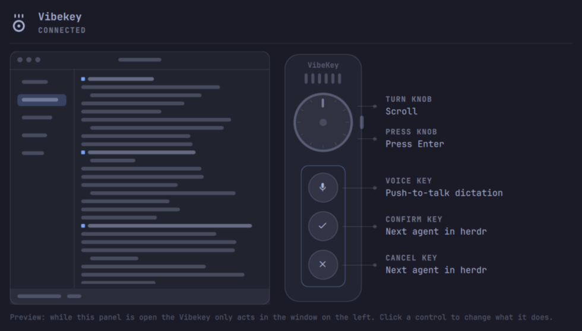
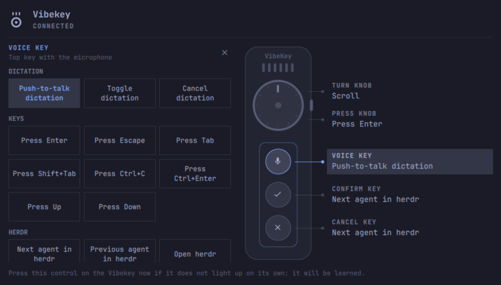
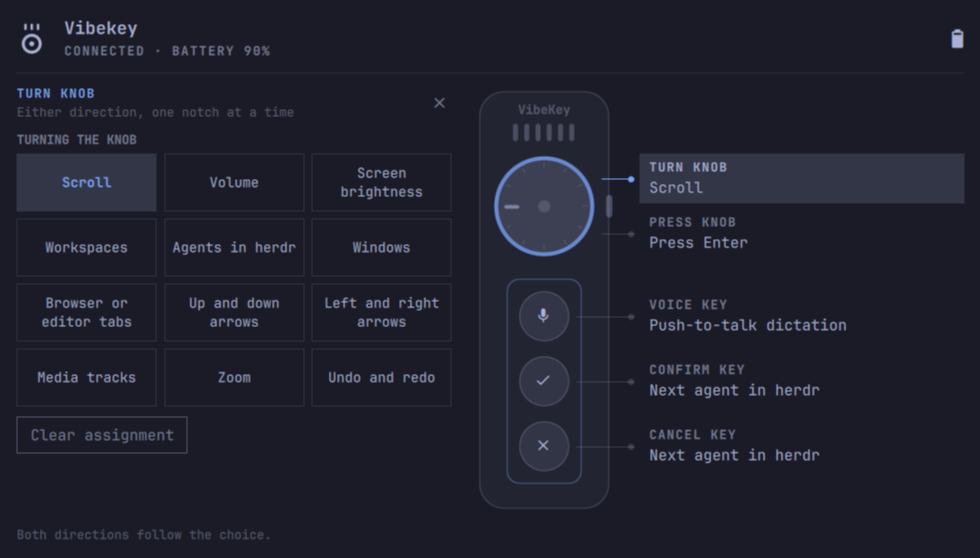
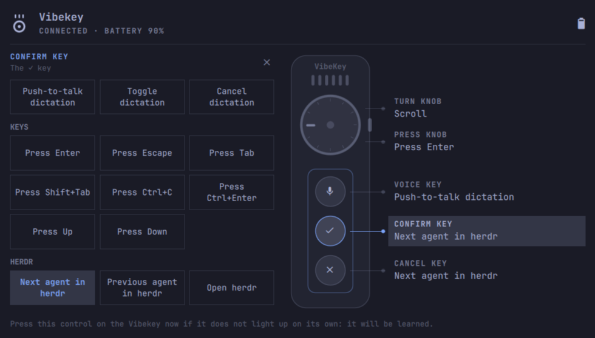

# Vibekey for Omarchy

Turn the [Ulanzi Vibekey](https://www.ulanzi.com/products/au05-vibe-key-ai-voice-input-keypad-i018)
(AU05), a small USB keypad with a knob, into a programmable control surface for
[Omarchy](https://omarchy.org). A Vibekey icon in the bar opens a panel drawn as
the keypad itself: assign any action to its three keys and the knob, see the
battery and connection status, and try every assignment in a live preview
before it runs for real.



```
  ┌───────────┐
  │  ◉ Voice  │     Voice key   → push-to-talk dictation
  │  ✓     ✕  │     ✓ Confirm   → next agent in herdr   ✕ Cancel → Ctrl+C
  │    (◎)    │     Knob press  → Enter                 turn → scroll
  └───────────┘
```

Out of the box the Vibekey is a plain keyboard that types Enter, Escape,
PrintScreen and arrows, and its Voice key sends a code Linux throws away. This
plugin reads the keypad directly, keeps those factory keystrokes away from your
apps, and runs whatever you picked instead. The assignments drawn above are the
ones it starts with; change any of them from the panel.

## Install

```bash
omarchy plugin add https://github.com/jimmibram/vibekey-driver.git --enable
```

That is the whole install: run that command, then click the Vibekey icon in
the bar and press **Grant device access**, and everything works. (The
marketplace lists this plugin as "manual setup"; that refers to the button.)

Pressing **Grant device access** installs one udev rule
(`/etc/udev/rules.d/70-ulanzi-vibekey.rules`) so your login may read the
keypad; it asks for your password once and needs no replug.

From a checkout, `./install.sh` does the same without git: it copies the plugin
into `~/.config/omarchy/plugins/`, enables it and installs the rule.

## Using it

The first time the driver runs it writes a starting set of assignments, so the
keypad is useful before you open the panel:

| Control | Does |
| --- | --- |
| Voice key | Push-to-talk dictation (hold to record, release to transcribe) |
| ✓ Confirm | Next agent in herdr |
| ✕ Cancel | Ctrl+C, interrupting the running agent |
| Knob press | Enter |
| Knob turn | Scroll, like a mouse wheel |

Click any control to pick what it does. Presets are grouped by purpose, and
there is a field for your own shell command or key combo.



The knob has its own set of modes, and the herdr presets flip between your
coding agents:

| Turning the knob | Flipping agents in herdr |
| --- | --- |
|  |  |

- Open the panel from the bar icon. On the right it draws the keypad with each
  control's assignment beside it; on the left a small mock herdr window with
  scribbled text. While the panel is open the keypad is in **preview**: nothing
  runs, the knob scrolls the mock window, the drawn knob turns with the real
  one, and a key press lights its control and shows its action in the mock
  window's status line.
- Click a control (on the drawing or its label) and the mock window gives way
  to a picker of grouped tiles: dictation (push-to-talk via voxtype), plain
  keys such as Enter, herdr, apps, Omarchy menus and panels, sound, screen,
  windows. At the bottom, a **custom command** through bash or a **key combo**
  such as `ctrl+shift+t`; Escape or the × goes back.
- **Turn knob** is one setting for both directions. The first choice, *Scroll*,
  lets the knob's own mouse-wheel reports through, so it scrolls like a wheel.
  The others pair the directions: volume, brightness, workspaces, agents in
  herdr, windows, tabs, arrows, media tracks, zoom, undo and redo.
- Changes apply immediately. The daemon picks the config up within a second.
- The keypad's own keystrokes (Enter, Escape, Backspace and so on) never reach
  your apps; only the assigned actions run.

Push-to-talk works because the daemon sees key releases too: a preset may carry a
`release_command`, and the Voice key runs `voxtype record start` on press and
`voxtype record stop` on release.

### A keypad remapped with Ulanzi Studio

The six controls are recognised by what they send from the factory. If you have
changed a key in Ulanzi Studio, click the key you mean in the drawing and press
it on the keypad: it is learned and from then on counts as that key. Learned
mappings are `aliases` in the config file.

## Flipping between agents in herdr

The presets **Next agent in herdr** and **Previous agent in herdr** run
`bin/vibekey-herdr-agent`. It finds the herdr TUI you have open (a local session,
`herdr --session`, `herdr --machine`, or `herdr --remote <host>`), asks that
session for its agents over the herdr socket API (through SSH for a remote
session, over a control socket it keeps open so a switch takes about a tenth of
a second), focuses the next or previous one, brings the herdr window to the
front and flashes the Vibekey icon where Omarchy's OSD sits. With no agents
running it flips between herdr workspaces instead; with no herdr open it says so.

## How it works

- `bin/vibekeyd` is a dependency-free Python daemon the panel starts and
  supervises. It finds the dongle (USB `fff1:00dd`), holds both of its raw HID
  channels open (the dongle reboots every four seconds otherwise), reads the
  keyboard, consumer and mouse reports straight from `hidraw`, and grabs the
  matching evdev nodes with `EVIOCGRAB` so the compositor never sees them.
  Battery level comes over the vendor channel (report `0x55`, TEA-encrypted),
  following the protocol documented by [MrCroxx/olanzi](https://github.com/MrCroxx/olanzi).
- The six controls are identified by what they send from the factory: Voice
  key = HID usage `0x01` (or Super+H, the Windows voice-typing shortcut, on
  some firmware), ✓ = Enter, ✕ = Escape, knob press = PrintScreen, knob turn =
  mouse wheel. Other firmware turns as Right/Backspace and presses as
  PrintScreen, or turns as wheel ticks and presses as Backspace; the daemon
  tells those apart by what it has seen. Anything else is a raw id you can
  learn as one of the six.
- While the panel is open it heartbeats `$XDG_RUNTIME_DIR/vibekey/preview`; the
  daemon then reports controls without running them and holds the wheel back.
- Assignments live in `~/.config/omarchy/vibekey/config.json`:

  ```json
  {
    "grab": true,
    "buttons": {
      "key1": { "preset": "dictation_ptt", "command": "voxtype record start", "release_command": "voxtype record stop" },
      "key2": { "keys": "Return" },
      "knob_right": { "command": "omarchy-audio-output-volume raise" }
    }
  }
  ```

  `bin/vibekey-config` edits it atomically (`show`, `set-button`, `set`), and the
  daemon reloads it on change. When the file does not exist yet the daemon
  writes it from the `defaults` block of `actions.json` (a preset id per
  control); a file you emptied yourself is left alone. Live state for the panel
  is in `$XDG_RUNTIME_DIR/vibekey/state.json`.
- `bin/vibekeyd --probe` prints every decoded control event; handy to see what
  your keypad sends.

## What it does to your system

Read this before installing; it is everything the plugin touches.

- **Background daemon.** While the widget is in the bar, the panel runs
  `bin/vibekeyd` as a child process. It opens the Vibekey's `/dev/hidraw*` and
  `/dev/input/event*` nodes, and **grabs** the keypad's keyboard events so the
  factory Enter/Escape/PrintScreen keystrokes never reach your apps. It stops
  when the shell does. `vibekeyd --no-grab` leaves them alone.
- **Runs your commands.** Whatever you assign to a control runs as you, through
  `bash -c`, from `~/.config/omarchy/vibekey/config.json`. The plugin never
  fetches or ships commands; the presets are listed in `actions.json`. Treat
  that config file like a shell profile: anyone who can write it can run
  commands as you.
- **One system file.** *Grant device access* installs
  `/etc/udev/rules.d/70-ulanzi-vibekey.rules` through `sudo`/`pkexec`, and
  nothing else needs root. The rule only matches USB `fff1:00dd` and grants the
  logged-in user access (`uaccess`) to that device's hidraw and input nodes.
  Remove it with `bin/vibekey-install-access --remove`.
- **Files it writes.** `~/.config/omarchy/vibekey/` (config, learned keys) and
  `$XDG_RUNTIME_DIR/vibekey/` (live state, preview heartbeat).
- **Network.** The daemon uses none. Only the optional *herdr agent* presets
  talk to a herdr session, locally or, with `--remote <host>`, over `ssh`
  (key-based, `BatchMode`, a control socket under `$XDG_RUNTIME_DIR/vibekey/`).

## Requirements

- Omarchy 4 (the Quickshell `omarchy-shell`), Python 3, `wtype` (ships with
  Omarchy) for the key-combo actions, `voxtype` for the dictation presets.
- The udev rule above, or membership of a group that may read `/dev/hidraw*`
  and `/dev/input/event*`.

## Uninstall

```bash
# optional: drop the udev rule first, while the helper still exists
~/.config/omarchy/plugins/jimmibram.vibekey/bin/vibekey-install-access --remove
omarchy plugin remove jimmibram.vibekey
```

## License

MIT. Not affiliated with Ulanzi. Protocol knowledge thanks to
[MrCroxx/olanzi](https://github.com/MrCroxx/olanzi) and
[kubja/ulanzi-vibekey](https://github.com/kubja/ulanzi-vibekey).
